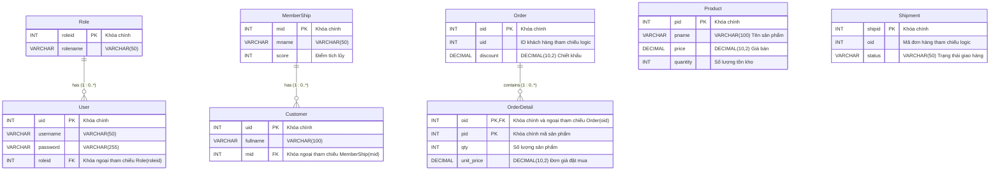
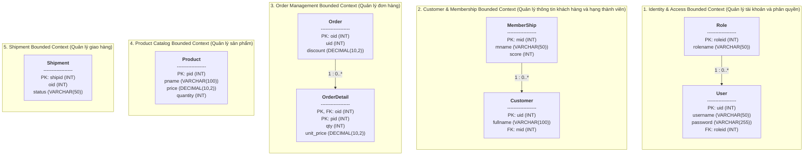

# Domain-Driven Design: Bounded Contexts

Tài liệu đặc tả các **Bounded Context** trong hệ thống E-commerce MVP theo phương pháp thiết kế hướng miền (**Domain-Driven Design - DDD**) và kiến trúc Microservices (Database-per-Service), được chuyển hóa từ sơ đồ thiết kế `Bounded-Context.jpg`.

---

## 1. Sơ đồ tổng quan Bounded Contexts (Mermaid Diagram)

### 1.1. Sơ đồ thực thể chi tiết (ER Diagram)

### 1.2. Sơ đồ phân vùng kiến trúc theo từng Bounded Context

---

## 2. Chi tiết 5 Bounded Contexts

### 2.1. 1. Identity & Access Bounded Context
> **Nhiệm vụ:** Quản lý tài khoản người dùng, xác thực (Authentication), mật khẩu và phân quyền vai trò (Authorization).

#### Bảng `User`
Lưu trữ thông tin tài khoản đăng nhập và liên kết vai trò của người dùng.

| Tên trường | Kiểu dữ liệu | Khóa | Ràng buộc | Diễn giải |
| :--- | :--- | :---: | :---: | :--- |
| `uid` | INT | **PK** | Not Null | Mã định danh tài khoản người dùng |
| `username` | VARCHAR(50) | | Not Null | Tên đăng nhập |
| `password` | VARCHAR(255) | | Not Null | Mật khẩu (đã được băm an toàn) |
| `roleid` | INT | **FK** | Not Null | Khóa ngoại tham chiếu đến `Role(roleid)` |

#### Bảng `Role`
Lưu trữ danh sách vai trò trong hệ thống (ví dụ: `admin`, `customer`, `staff`).

| Tên trường | Kiểu dữ liệu | Khóa | Ràng buộc | Diễn giải |
| :--- | :--- | :---: | :---: | :--- |
| `roleid` | INT | **PK** | Not Null | Mã vai trò |
| `rolename` | VARCHAR(50) | | Not Null | Tên vai trò |

- **Quan hệ nội bộ:** `Role` (1) - (0..*) `User`: Một vai trò có thể cấp cho 0 hoặc nhiều tài khoản người dùng.

---

### 2.2. 2. Customer & Membership Bounded Context
> **Nhiệm vụ:** Quản lý hồ sơ thông tin khách hàng, phân hạng thành viên (Tier) và quản lý điểm tích lũy (`score`).

#### Bảng `Customer`
Lưu trữ thông tin hồ sơ cá nhân của khách hàng và cấp độ thành viên hiện tại.

| Tên trường | Kiểu dữ liệu | Khóa | Ràng buộc | Diễn giải |
| :--- | :--- | :---: | :---: | :--- |
| `uid` | INT | **PK** | Not Null | Mã khách hàng (trùng với `uid` từ Identity Context) |
| `fullname` | VARCHAR(100) | | Not Null | Họ và tên đầy đủ |
| `mid` | INT | **FK** | Not Null | Khóa ngoại tham chiếu đến `MemberShip(mid)` |

#### Bảng `MemberShip`
Định nghĩa các bậc thành viên và điểm số yêu cầu / tích lũy.

| Tên trường | Kiểu dữ liệu | Khóa | Ràng buộc | Diễn giải |
| :--- | :--- | :---: | :---: | :--- |
| `mid` | INT | **PK** | Not Null | Mã hạng thành viên |
| `mname` | VARCHAR(50) | | Not Null | Tên hạng thành viên (VD: Silver, Gold, Platinum) |
| `score` | INT | | Not Null | Mốc điểm số yêu cầu hoặc tích lũy |

- **Quan hệ nội bộ:** `MemberShip` (1) - (0..*) `Customer`: Một hạng thành viên bao gồm 0 hoặc nhiều khách hàng.

---

### 2.3. 3. Order Management Bounded Context
> **Nhiệm vụ:** Tiếp nhận và xử lý đặt hàng, áp dụng giảm giá (discount) theo score của khách hàng, và lưu trữ chi tiết dòng hàng của đơn.

#### Bảng `Order`
Lưu trữ thông tin tổng quát của đơn đặt hàng.

| Tên trường | Kiểu dữ liệu | Khóa | Ràng buộc | Diễn giải |
| :--- | :--- | :---: | :---: | :--- |
| `oid` | INT | **PK** | Not Null | Mã đơn đặt hàng |
| `uid` | INT | | Not Null | ID khách hàng đặt hàng (Logical Reference từ Customer Context) |
| `discount` | DECIMAL(10,2) | | Not Null | Giá trị tiền giảm trừ áp dụng cho đơn hàng |

#### Bảng `OrderDetail`
Lưu trữ danh sách các mặt hàng thuộc đơn hàng.

| Tên trường | Kiểu dữ liệu | Khóa | Ràng buộc | Diễn giải |
| :--- | :--- | :---: | :---: | :--- |
| `oid` | INT | **PK, FK** | Not Null | Khóa chính & Khóa ngoại tham chiếu `Order(oid)` |
| `pid` | INT | **PK** | Not Null | Khóa chính (Mã sản phẩm đặt mua) |
| `qty` | INT | | Not Null | Số lượng mua |
| `unit_price` | DECIMAL(10,2) | | Not Null | Đơn giá tại thời điểm tạo đơn |

- **Quan hệ nội bộ:** `Order` (1) - (0..*) `OrderDetail`: Một đơn hàng gồm 0 hoặc nhiều chi tiết mặt hàng. Cặp `(oid, pid)` tạo thành khóa chính phức hợp (Composite PK) cho `OrderDetail`.

---

### 2.4. 4. Product Catalog Bounded Context
> **Nhiệm vụ:** Quản lý danh mục sản phẩm, thông tin giá niêm yết và số lượng hàng tồn kho.

#### Bảng `Product`
Lưu trữ thông tin chi tiết của từng sản phẩm.

| Tên trường | Kiểu dữ liệu | Khóa | Ràng buộc | Diễn giải |
| :--- | :--- | :---: | :---: | :--- |
| `pid` | INT | **PK** | Not Null | Mã định danh sản phẩm |
| `pname` | VARCHAR(100) | | Not Null | Tên sản phẩm |
| `price` | DECIMAL(10,2) | | Not Null | Giá bán niêm yết hiện hành |
| `quantity` | INT | | Not Null | Số lượng sản phẩm còn tồn kho |

---

### 2.5. 5. Shipment Bounded Context
> **Nhiệm vụ:** Tiếp nhận yêu cầu vận chuyển từ đơn hàng hoàn tất và theo dõi trạng thái giao hàng.

#### Bảng `Shipment`
Lưu trữ dữ liệu hành trình và trạng thái vận chuyển của đơn hàng.

| Tên trường | Kiểu dữ liệu | Khóa | Ràng buộc | Diễn giải |
| :--- | :--- | :---: | :---: | :--- |
| `shipid` | INT | **PK** | Not Null | Mã vận đơn / giao nhận |
| `oid` | INT | | Not Null | Mã đơn hàng tương ứng (Logical Reference từ Order Context) |
| `status` | VARCHAR(50) | | Not Null | Trạng thái giao hàng (VD: `Pending`, `Shipped`, `Delivered`, `Cancelled`) |

---

## 3. Bản đồ ranh giới và Phân tích so với Kiến trúc Monolith (ERD)

Trong mô hình kiến trúc Microservices và Domain-Driven Design (DDD):

| Tiêu chí | Mô hình ERD nguyên khối (Monolith) | Mô hình Bounded Context (DDD / Microservices) |
| :--- | :--- | :--- |
| **Phân rã thực thể User** | Gom chung `uid`, `username`, `fullname`, `password`, `roleid`, `mid` vào một bảng duy nhất `User`. | **Tách biệt ranh giới:** - Ngữ cảnh Identity quản lý `User` (`uid`, `username`, `password`, `roleid`). - Ngữ cảnh Customer quản lý `Customer` (`uid`, `fullname`, `mid`). |
| **Ràng buộc khóa ngoại (Foreign Keys)** | Sử dụng Foreign Key vật lý ở cấp Database Engine giữa tất cả các bảng. | **Database-per-Service:** Khóa ngoại cứng chỉ tồn tại **trong nội bộ** từng Bounded Context. Giao tiếp liên Context sử dụng **Logical ID / Event-driven** (VD: `Order.uid`, `Order.discount`, `Shipment.oid`, `OrderDetail.pid`). |
| **Tính toán chiết khấu (Discount)** | Tính trực tiếp qua truy vấn JOIN giữa các bảng `Order`, `User`, `MemberShip`. | Dịch vụ Order sẽ truy vấn dịch vụ Customer để lấy thông tin `score`, tính toán mức giảm giá và ghi nhận trực tiếp vào trường `Order.discount`. |
| **Giao vận (Shipment)** | Ràng buộc FK cứng `Shipment.oid -> Order.oid`. | Dịch vụ Shipment lưu `oid` như một khóa logic, nhận sự kiện (hoặc REST API call) khi đơn hàng được tạo để khởi tạo vận đơn. |
