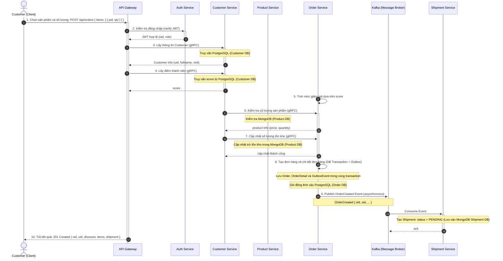

# Business Process Model: Luồng chính Đặt hàng và Giao hàng

> **Tài liệu đặc tả quy trình nghiệp vụ (Business Process Model - BPM)** trong hệ thống E-commerce MVP theo kiến trúc **Microservices, Domain-Driven Design (DDD)** và mô hình **Database-per-Service**, được chuyển hóa chuẩn xác từ sơ đồ thiết kế `Business-Process-Model.png`.

---

## 1. Tổng quan quy trình nghiệp vụ (High-Level Business Process Flow)

Tên luồng: **Luồng chính: Đặt hàng và chuyển cho bộ phận giao hàng**  
Quy trình mô tả chuỗi 10 bước nghiệp vụ tuần tự từ lúc Khách hàng (Customer) gửi yêu cầu đặt mua sản phẩm trên giao diện Client, qua các dịch vụ nội bộ để thẩm định thông tin, kiểm tra kho, tính chiết khấu thành viên, ghi nhận giao dịch vào cơ sở dữ liệu, phát sự kiện sang hệ thống giao vận (Shipment), và phản hồi kết quả thành công cho người dùng.

### 1.1. Sơ đồ luồng 10 bước nghiệp vụ (Process Step Workflow)

```mermaid
flowchart LR
    step1["1. Customer chọn sản phẩm và số lượng"]
    step2["2. Hệ thống kiểm tra thông tin đăng nhập"]
    step3["3. Hệ thống lấy thông tin Customer"]
    step4["4. Hệ thống lấy điểm thành viên"]
    step5["5. Hệ thống tính mức giảm giá"]
    step6["6. Hệ thống kiểm tra số lượng sản phẩm"]
    step7["7. Hệ thống cập nhật số lượng tồn kho"]
    step8["8. Hệ thống tạo đơn hàng và chi tiết đơn hàng"]
    step9["9. Hệ thống chuyển đơn hàng cho bộ phận giao hàng"]
    step10["10. Hệ thống trả kết quả cho Customer"]

    step1 --> step2 --> step3 --> step4 --> step5 --> step6 --> step7 --> step8 --> step9 --> step10

    classDef blueStep fill:#e1f5fe,stroke:#0288d1,stroke-width:2px,color:#01579b;
    classDef yellowStep fill:#fffde7,stroke:#fbc02d,stroke-width:2px,color:#f57f17;
    classDef greenStep fill:#e8f5e9,stroke:#4caf50,stroke-width:2px,color:#1b5e20;
    classDef purpleStep fill:#f3e5f5,stroke:#ab47bc,stroke-width:2px,color:#4a148c;
    classDef redStep fill:#ffebee,stroke:#e53935,stroke-width:2px,color:#b71c1c;

    class step1,step8,step10 blueStep;
    class step2 yellowStep;
    class step3,step4 greenStep;
    class step5,step9 purpleStep;
    class step6,step7 redStep;
```



### 1.2. Bảng mô tả 10 bước nghiệp vụ tổng quan

| Bước | Biểu tượng (Icon) | Màu thẻ | Tên bước | Đơn vị / Service thực hiện | Mô tả nghiệp vụ |
| :---: | :---: | :---: | :--- | :--- | :--- |
| **1** | Giỏ hàng (Cart) | Xanh dương | **Customer chọn sản phẩm và số lượng** | Customer (Client) | Khách hàng chọn danh sách sản phẩm cần mua và số lượng tương ứng, gửi lệnh đặt hàng. |
| **2** | Ổ khóa (Lock) | Vàng cam | **Hệ thống kiểm tra thông tin đăng nhập** | API Gateway & Auth Service | Xác thực tính hợp lệ của JWT token gửi kèm trong header request. |
| **3** | Nhóm khách hàng (People) | Xanh lá | **Hệ thống lấy thông tin Customer** | Customer Service | Truy vấn dữ liệu khách hàng theo `uid` (họ tên, mã hạng thành viên `mid`). |
| **4** | Huy hiệu / Huân chương (Medal) | Xanh lá đậm | **Hệ thống lấy điểm thành viên** | Customer Service | Lấy điểm tích lũy (`score`) tương ứng với hạng thẻ thành viên của khách hàng. |
| **5** | Phần trăm (%) | Tím | **Hệ thống tính mức giảm giá** | Order Service | Tính toán số tiền chiết khấu (`discount`) dựa trên quy tắc điểm `score`. |
| **6** | Kiện hàng đóng gói (Box) | Đỏ | **Hệ thống kiểm tra số lượng sản phẩm** | Product Service | Xác thực thông tin sản phẩm (giá bán hiện tại, kiểm tra tồn kho đủ số lượng `qty <= quantity`). |
| **7** | Kiện hàng mở nắp (Open Box) | Đỏ cam | **Hệ thống cập nhật số lượng tồn kho** | Product Service | Trừ số lượng tồn kho của các sản phẩm tương ứng với số lượng đặt mua (`quantity = quantity - qty`). |
| **8** | Hóa đơn (Invoice) | Xanh dương | **Hệ thống tạo đơn hàng và chi tiết đơn hàng** | Order Service | Khởi tạo giao dịch DB lưu bản ghi `Order`, `OrderDetail` và `OutboxEvent` (Transactional Outbox Pattern). |
| **9** | Xe tải giao hàng (Truck) | Tím hồng | **Hệ thống chuyển đơn hàng cho bộ phận giao hàng** | Kafka & Shipment Service | Xuất bản sự kiện `OrderCreated` vào Kafka topic; Shipment Service tiếp nhận và tạo vận đơn (`PENDING`). |
| **10** | Dấu kiểm hoàn tất (Checkmark) | Xanh dương | **Hệ thống trả kết quả cho Customer** | API Gateway & Customer | Trả về mã phản hồi `201 Created` kèm thông tin đơn hàng đã tạo thành công cho người dùng. |

---

## 2. Sơ đồ tương tác Microservices (Sequence Diagram)

Sơ đồ tuần tự thể hiện sự phối hợp chi tiết giữa **Customer (Client)**, **API Gateway**, **5 Microservices**, **Message Broker (Kafka)** và các hệ quản trị cơ sở dữ liệu riêng biệt (**Database-per-Service**).



> [!NOTE]
> **Ghi chú về luồng thực thi kỹ thuật (Architectural Realization):**  
> Trong sơ đồ nguyên bản `Business-Process-Model.png`, các mũi tên gRPC ở bước 6 và bước 7 nối giữa thanh kích hoạt của Customer Service và Order Service đi ngang qua Product Service. Trong kiến trúc triển khai thực tế (theo `Microservice-Architecture-Design.jpg` và Use Case `UC06`/`UC08`):
> - **API Gateway / Order Service** đóng vai trò Service Orchestrator: Sau khi nhận thông tin khách hàng và điểm `score`, Order Service thực hiện gọi gRPC trực tiếp sang **Product Service** để kiểm tra tồn kho (`price, quantity`) và cập nhật giảm tồn kho trong `MongoDB (Product DB)`.
> - Cả hai góc nhìn (nguyên văn theo hình vẽ và chi tiết kỹ thuật phân quyền Bounded Context) đều đảm bảo cùng một mục đích nghiệp vụ: sản phẩm phải còn đủ số lượng và được cập nhật tồn kho an toàn trước khi `Order` được commit.

---

## 3. Đặc tả chi tiết từng bước tương tác (Detailed Step Specifications)

### Bước 1: Customer chọn sản phẩm và số lượng
- **Người gửi (Sender):** Customer (Client Web / Mobile App)
- **Người nhận (Receiver):** API Gateway
- **Giao thức:** HTTP/1.1 hoặc HTTP/2 RESTful API (`POST`)
- **Endpoint:** `POST /api/orders`
- **Headers:** `Authorization: Bearer <JWT_TOKEN>`, `Content-Type: application/json`
- **Request Body (Payload):**
  ```json
  {
    "items": [
      {
        "pid": 101,
        "qty": 2
      },
      {
        "pid": 102,
        "qty": 1
      }
    ]
  }
  ```
- **Mô tả logic:** Khách hàng duyệt sản phẩm, thêm vào giỏ và bấm thanh toán/đặt hàng. Request được gửi tới cổng đầu vào duy nhất của hệ thống là API Gateway.

---

### Bước 2: Kiểm tra đăng nhập (Verify JWT)
- **Người gửi (Sender):** API Gateway
- **Người nhận (Receiver):** Auth Service
- **Giao thức:** Đồng bộ (gRPC / Internal REST / Middleware JWT verification)
- **Nội dung yêu cầu:** `verify JWT` được trích xuất từ `Bearer Token`
- **Kết quả trả về:**
  - `JWT hợp lệ (uid, role)`: Token hợp lệ, chứa mã định danh người dùng (`uid`) và quyền truy cập (`role`).
  - Nếu token không hợp lệ hoặc hết hạn: Trả ngay mã lỗi `401 Unauthorized` và ngắt luồng.
- **Mô tả logic:** API Gateway đóng vai trò là Enforcement Point, kiểm tra chữ ký và tính hợp lệ của token (có thể tra cứu blacklist token trên Redis Cache) trước khi cho phép request đi tiếp vào mạng nội bộ.

---

### Bước 3: Lấy thông tin Customer
- **Người gửi (Sender):** API Gateway
- **Người nhận (Receiver):** Customer Service
- **Giao thức:** gRPC (Synchronous Remote Procedure Call)
- **Input:** `uid` (lấy từ JWT đã xác thực ở Bước 2)
- **Output:** `Customer info (uid, fullname, mid)`
- **Cơ sở dữ liệu liên quan:** `PostgreSQL (Customer DB)`
  - Truy vấn bảng `Customer` dựa trên khóa chính `uid`.
- **Mô tả logic:** Lấy thông tin hồ sơ của khách hàng, đặc biệt là mã hạng thành viên `mid` (Membership ID) để phục vụ việc xác định chính sách ưu đãi.

---

### Bước 4: Lấy điểm thành viên
- **Người gửi (Sender):** API Gateway
- **Người nhận (Receiver):** Customer Service
- **Giao thức:** gRPC (Synchronous)
- **Input:** `mid` (hoặc `uid`)
- **Output:** `score` (Điểm tích lũy thành viên)
- **Cơ sở dữ liệu liên quan:** `PostgreSQL (Customer DB)`
  - Truy vấn bảng `MemberShip` để lấy thuộc tính `score`.
- **Mô tả logic:** Lấy điểm tích lũy của khách hàng để làm căn cứ tính toán mức chiết khấu giảm giá cho đơn hàng.

---

### Bước 5: Tính mức giảm giá dựa trên điểm thành viên
- **Thành phần thực thi:** Order Service (Internal Business Domain Logic)
- **Input:** `score` (nhận từ context khách hàng), tổng giá trị sản phẩm đơn hàng
- **Output:** `discount` (Số tiền được giảm, kiểu `DECIMAL(10,2)`)
- **Quy tắc nghiệp vụ (Business Rules - FR08 / UC07):**
  - Hệ thống áp dụng chính sách giảm giá tỷ lệ thuận theo bậc điểm thành viên `score`.
  - Mức giảm giá được trừ trực tiếp vào tổng tiền thanh toán của đơn hàng và lưu vào thuộc tính `discount` của đối tượng `Order`.

---

### Bước 6: Kiểm tra số lượng sản phẩm
- **Giao tiếp:** gRPC giữa Order Service / Gateway và Product Service
- **Input:** Danh sách các mã sản phẩm và số lượng yêu cầu `[ { pid, qty } ]`
- **Output:** `product info (price, quantity)`
- **Cơ sở dữ liệu liên quan:** `MongoDB (Product DB)`
  - Truy vấn collection `products` theo `pid`.
- **Quy tắc nghiệp vụ (FR06, UC06):**
  - Kiểm tra từng sản phẩm có tồn tại và đang hoạt động hay không.
  - Kiểm tra điều kiện tồn kho: với mỗi sản phẩm, yêu cầu `qty <= quantity`.
  - Nếu bất kỳ sản phẩm nào có `qty > quantity`, lập tức từ chối và phản hồi lỗi `409 Conflict` (hoặc `400 Bad Request` - Hết hàng / Không đủ số lượng tồn kho).

---

### Bước 7: Cập nhật số lượng tồn kho
- **Giao tiếp:** gRPC (Synchronous)
- **Input:** Danh sách trừ kho `[ { pid, qty } ]`
- **Output:** `cập nhật thành công` (Status OK / Boolean)
- **Cơ sở dữ liệu liên quan:** `MongoDB (Product DB)`
  - Thực hiện cập nhật nguyên tử (Atomic Update):
    $$\text{quantity}_{\text{mới}} = \text{quantity}_{\text{cũ}} - \text{qty}$$
- **Mô tả logic:** Sau khi xác nhận kho còn đủ hàng, hệ thống tiến hành trừ số lượng tồn kho thực tế để giữ chỗ (reserve) hàng hóa cho đơn hàng đang được tạo.

---

### Bước 8: Tạo đơn hàng và chi tiết đơn hàng (DB Transaction + Outbox)
- **Thành phần thực thi:** Order Service
- **Cơ sở dữ liệu liên quan:** `PostgreSQL (Order DB)`
- **Cơ chế:** **Database Transaction (ACID)** kết hợp mô hình **Transactional Outbox Pattern**
- **Nội dung thực thi trong cùng một Transaction duy nhất:**
  1. `INSERT INTO orders (oid, uid, discount)`: Ghi nhận thông tin đơn hàng tổng quát.
  2. `INSERT INTO order_details (oid, pid, qty, unit_price)`: Ghi nhận từng dòng chi tiết đơn hàng kèm đơn giá tại thời điểm chốt đơn.
  3. `INSERT INTO outbox_events (event_id, event_type, payload, status, created_at)`: Ghi nhận sự kiện `OrderCreated` với trạng thái `PENDING`.
  4. `COMMIT TRANSACTION`: Cam kết dữ liệu. Nếu có bất kỳ lỗi nào xảy ra trong quá trình ghi, toàn bộ thao tác được `ROLLBACK` an toàn, ngăn chặn tình trạng dữ liệu mồ côi (Inconsistent State).

---

### Bước 9: Chuyển đơn hàng cho bộ phận giao hàng (Event-Driven Messaging)
- **Giai đoạn 9a: Publish Event (Asynchronous)**
  - **Người gửi (Publisher):** Order Service (Outbox Publisher / Worker)
  - **Kênh trung gian (Message Broker):** Apache Kafka (Topic: `order-created`)
  - **Nội dung sự kiện (Event Payload):**
    ```json
    {
      "eventType": "OrderCreated",
      "timestamp": "2026-10-27T00:27:00Z",
      "data": {
        "oid": 1001,
        "uid": 42,
        "items": [
          { "pid": 101, "qty": 2, "unit_price": 150.00 }
        ],
        "discount": 15.00
      }
    }
    ```
- **Giai đoạn 9b: Consume Event & Tạo đơn giao nhận**
  - **Người nhận (Consumer):** Shipment Service
  - **Cơ sở dữ liệu liên quan:** `MongoDB (Shipment DB)`
  - **Hành động xử lý:**
    - Tiếp nhận sự kiện `OrderCreated` từ Kafka.
    - Tạo mới một bản ghi vận chuyển: `Shipment { shipid, oid, status: "PENDING" }`.
    - Đảm bảo cơ chế Idempotent Consumer (tránh tạo 2 vận đơn cho cùng một mã `oid` khi nhận duplicate event).

---

### Bước 10: Trả kết quả cho Customer
- **Người gửi (Sender):** API Gateway
- **Người nhận (Receiver):** Customer (Client)
- **Mã trạng thái phản hồi HTTP:** `201 Created`
- **Dữ liệu phản hồi (Response Payload):**
  ```json
  {
    "success": true,
    "message": "Đơn hàng đã được tạo thành công",
    "order": {
      "oid": 1001,
      "uid": 42,
      "discount": 15.00,
      "items": [
        {
          "pid": 101,
          "qty": 2,
          "unit_price": 150.00
        }
      ],
      "shipment": {
        "shipid": 5001,
        "status": "PENDING"
      }
    }
  }
  ```
- **Mô tả logic:** Hoàn tất chu trình đặt hàng đồng bộ đối với người dùng. Khách hàng nhận được mã đơn hàng (`oid`) cùng toàn bộ chi tiết thanh toán ngay lập tức.

---

## 4. Bảng thành phần hệ thống & Phân vùng cơ sở dữ liệu (Database-per-Service)

Bảng đối chiếu các thành phần phần mềm xuất hiện trong mô hình quy trình và công nghệ cơ sở dữ liệu tương ứng:

| Thành phần (Component) | Loại hình (Type) | Công nghệ / DB | Bounded Context tương ứng | Nhiệm vụ chính trong quy trình |
| :--- | :--- | :--- | :--- | :--- |
| **Customer (Client)** | Frontend Client | Web / Mobile App | Khách hàng cuối | Khởi tạo hành động đặt hàng, nhận kết quả đơn hàng. |
| **API Gateway** | Gateway Layer | Node.js / Redis | Hạ tầng / Routing | Điểm truy cập tập trung, xác thực JWT, định tuyến, rate limiting, logging. |
| **Auth Service** | Microservice | PostgreSQL (Auth DB) | Identity & Access | Xác thực tài khoản, kiểm tra chữ ký & tính hợp lệ của JWT token. |
| **Customer Service** | Microservice | PostgreSQL (Customer DB) | Customer & Membership | Quản lý thông tin khách hàng, thẻ thành viên và cung cấp điểm `score`. |
| **Product Service** | Microservice | MongoDB (Product DB) | Product Catalog | Quản lý danh mục hàng hóa, kiểm tra số lượng và trừ tồn kho khi mua. |
| **Order Service** | Microservice | PostgreSQL (Order DB) | Order Management | Tính chiết khấu, tạo đơn hàng, lưu chi tiết và quản lý Outbox Event. |
| **Kafka** | Message Broker | Apache Kafka Cluster | Messaging Bus | Truyền tải sự kiện bất đồng bộ `OrderCreated` giữa Order Service và Shipment Service. |
| **Shipment Service** | Microservice | MongoDB (Shipment DB) | Shipment | Nhận sự kiện đơn hàng, tạo vận đơn mới với trạng thái `PENDING`. |

---

## 5. Các Design Patterns cốt lõi áp dụng trong mô hình

1. **Database-per-Service Pattern**:
   - Mỗi microservice sở hữu cơ sở dữ liệu độc lập (`PostgreSQL` cho Auth, Customer, Order; `MongoDB` cho Product, Shipment).
   - Không có bất kỳ truy vấn trực tiếp (direct cross-database query) nào giữa các service; mọi trao đổi dữ liệu đều thông qua giao diện chuẩn (gRPC nội bộ hoặc Kafka Event).

2. **Transactional Outbox Pattern**:
   - Giải quyết triệt để bài toán **Dual-Write Problem** giữa cơ sở dữ liệu quan hệ (`PostgreSQL`) và Message Broker (`Kafka`).
   - Bản ghi đơn hàng (`Order`) và thông điệp sự kiện (`OutboxEvent`) được commit trong cùng một ACID transaction tại Order Service. Worker sẽ quét bảng Outbox để publish lên Kafka, đảm bảo tính gửi sự kiện đáng tin cậy (**At-least-once delivery**).

3. **Event-Driven Choreography Architecture**:
   - Giảm thiểu sự phụ thuộc trực tiếp (loose coupling) giữa Order Service và Shipment Service.
   - Khi đơn hàng được tạo, Order Service không cần chờ Shipment Service phản hồi mà chỉ phát sự kiện và hoàn tất đơn cho khách hàng; việc tạo vận đơn diễn ra ngầm không gây nghẽn luồng người dùng.

4. **API Gateway Aggregation & Enforcement**:
   - Tập trung hóa xác thực bảo mật (JWT Verification) và đóng vai trò điều phối giao tiếp giữa khách hàng với các dịch vụ nghiệp vụ nội bộ.

---

## 6. Ma trận ánh xạ Yêu cầu chức năng (Traceability Matrix)

| Bước trong Quy trình BPM | Mã Use Case (UC) | Mã Yêu cầu (FR) | Mã Yêu cầu nghiệp vụ (BR) | Mã Test Case (TC) |
| :---: | :---: | :---: | :---: | :---: |
| **Bước 1** | `UC06` (Place order) | `FR07` (Đặt hàng) | `BR04` | `TC-ORD-01`, `TC-ORD-02` |
| **Bước 2** | `UC02` (Login / Verify) | `FR02` (Xác thực) | `BR02` | `TC-ORD-02` |
| **Bước 3 & 4** | `UC03`, `UC07` | `FR03`, `FR08` | `BR01`, `BR05` | `TC-ORD-04` |
| **Bước 5** | `UC07` (Calculate discount)| `FR08` (Tính giảm giá)| `BR05` | `TC-ORD-04` |
| **Bước 6 & 7** | `UC08` (Update inventory)| `FR09` (Cập nhật kho) | `BR03` | `TC-ORD-03` |
| **Bước 8** | `UC09` (Create order) | `FR07` (Lưu đơn hàng) | `BR04` | `TC-ORD-01`, `TC-ORD-05` |
| **Bước 9** | `UC06`, `UC11` | `FR11` (Giao hàng) | `BR06` | `TC-ORD-05`, `TC-SHP-01` |
| **Bước 10** | `UC06` (Place order) | `FR07` (Đặt hàng) | `BR04` | `TC-ORD-01` |
