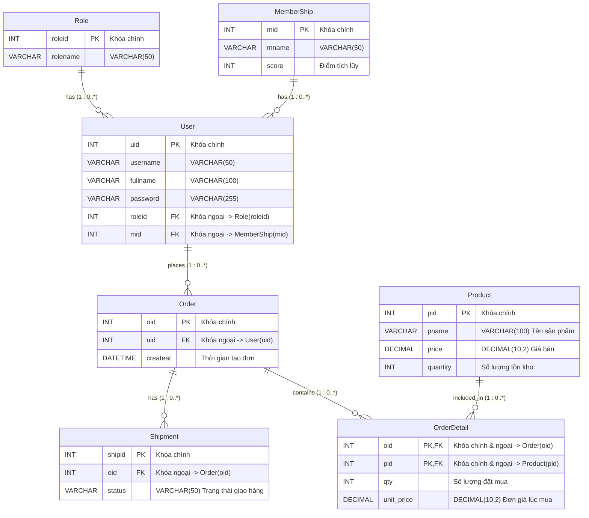

# Database Design & ER Diagram

Tài liệu mô tả thiết kế cơ sở dữ liệu và sơ đồ quan hệ thực thể (ER Diagram) cho hệ thống E-commerce.

---

## 1. ER Diagram (Mermaid)

---

## 2. Chi tiết các bảng (Data Dictionary)

### 2.1. Bảng `Role`
Lưu trữ thông tin vai trò/quyền hạn của người dùng trong hệ thống (VD: `admin`, `normal`).

| Tên thuộc tính | Kiểu dữ liệu | Khóa | Nullable | Ghi chú |
| :--- | :--- | :---: | :---: | :--- |
| `roleid` | INT | **PK** | Không | Mã định danh vai trò (Primary Key) |
| `rolename` | VARCHAR(50) | | Không | Tên vai trò |

### 2.2. Bảng `MemberShip`
Quản lý cấp độ/hạng thành viên và điểm tích lũy của khách hàng.

| Tên thuộc tính | Kiểu dữ liệu | Khóa | Nullable | Ghi chú |
| :--- | :--- | :---: | :---: | :--- |
| `mid` | INT | **PK** | Không | Mã định danh hạng thành viên (Primary Key) |
| `mname` | VARCHAR(50) | | Không | Tên hạng thành viên |
| `score` | INT | | Không | Điểm số tích lũy / yêu cầu của hạng |

### 2.3. Bảng `User`
Lưu trữ thông tin tài khoản người dùng trong hệ thống.

| Tên thuộc tính | Kiểu dữ liệu | Khóa | Nullable | Ghi chú |
| :--- | :--- | :---: | :---: | :--- |
| `uid` | INT | **PK** | Không | Mã định danh người dùng (Primary Key) |
| `username` | VARCHAR(50) | | Không | Tên đăng nhập |
| `fullname` | VARCHAR(100) | | Không | Họ và tên đầy đủ |
| `password` | VARCHAR(255) | | Không | Mật khẩu (đã mã hóa hash) |
| `roleid` | INT | **FK** | Không | Khóa ngoại tham chiếu `Role(roleid)` |
| `mid` | INT | **FK** | Có | Khóa ngoại tham chiếu `MemberShip(mid)` |

### 2.4. Bảng `Order`
Lưu trữ thông tin đơn hàng do người dùng tạo.

| Tên thuộc tính | Kiểu dữ liệu | Khóa | Nullable | Ghi chú |
| :--- | :--- | :---: | :---: | :--- |
| `oid` | INT | **PK** | Không | Mã đơn hàng (Primary Key) |
| `uid` | INT | **FK** | Không | Khóa ngoại tham chiếu `User(uid)` |
| `createat` | DATETIME | | Không | Thời gian đặt hàng (mặc định lấy thời gian hiện hành) |

### 2.5. Bảng `Shipment`
Quản lý thông tin giao vận và trạng thái đơn hàng.

| Tên thuộc tính | Kiểu dữ liệu | Khóa | Nullable | Ghi chú |
| :--- | :--- | :---: | :---: | :--- |
| `shipid` | INT | **PK** | Không | Mã giao vận (Primary Key) |
| `oid` | INT | **FK** | Không | Khóa ngoại tham chiếu `Order(oid)` |
| `status` | VARCHAR(50) | | Không | Trạng thái giao hàng (VD: Pending, Shipping, Delivered) |

### 2.6. Bảng `Product`
Lưu trữ danh mục sản phẩm và quản lý tồn kho.

| Tên thuộc tính | Kiểu dữ liệu | Khóa | Nullable | Ghi chú |
| :--- | :--- | :---: | :---: | :--- |
| `pid` | INT | **PK** | Không | Mã sản phẩm (Primary Key) |
| `pname` | VARCHAR(100) | | Không | Tên sản phẩm |
| `price` | DECIMAL(10,2) | | Không | Đơn giá sản phẩm |
| `quantity` | INT | | Không | Số lượng hàng tồn kho |

### 2.7. Bảng `OrderDetail`
Bảng trung gian chi tiết đơn hàng, liên kết giữa `Order` và `Product`.

| Tên thuộc tính | Kiểu dữ liệu | Khóa | Nullable | Ghi chú |
| :--- | :--- | :---: | :---: | :--- |
| `oid` | INT | **PK, FK** | Không | Khóa chính & ngoại tham chiếu `Order(oid)` |
| `pid` | INT | **PK, FK** | Không | Khóa chính & ngoại tham chiếu `Product(pid)` |
| `qty` | INT | | Không | Số lượng sản phẩm mua |
| `unit_price` | DECIMAL(10,2) | | Không | Đơn giá sản phẩm tại thời điểm đặt mua |

---

## 3. Quan hệ giữa các thực thể (Relationships & Cardinality)

- **Role - User (1 : 0..*)**: Một vai trò có thể được gán cho 0 hoặc nhiều người dùng; mỗi người dùng bắt buộc thuộc về 1 vai trò (`roleid`).
- **MemberShip - User (1 : 0..*)**: Một hạng thành viên có thể thuộc về 0 hoặc nhiều người dùng; mỗi người dùng thuộc về 1 hạng thành viên (`mid`).
- **User - Order (1 : 0..*)**: Một người dùng có thể thực hiện 0 hoặc nhiều đơn đặt hàng; mỗi đơn hàng thuộc về chính xác 1 người dùng (`uid`).
- **Order - Shipment (1 : 0..*)**: Một đơn hàng có thể có 0 hoặc nhiều thông tin/trạng thái giao vận (`oid`).
- **Order - OrderDetail (1 : 0..*)**: Một đơn hàng có thể gồm 0 hoặc nhiều chi tiết mặt hàng (`oid`).
- **Product - OrderDetail (1 : 0..*)**: Một sản phẩm có thể có mặt trong 0 hoặc nhiều chi tiết đơn hàng (`pid`).

