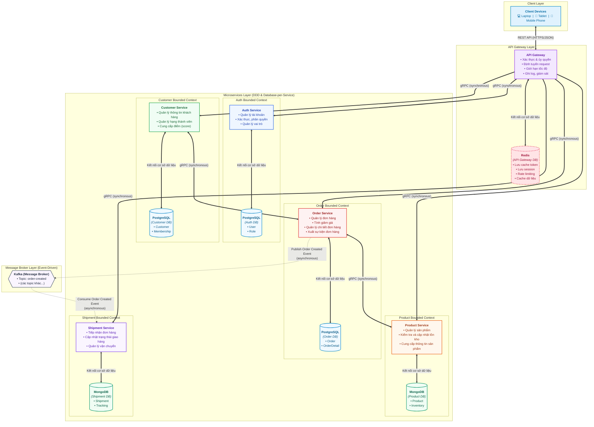
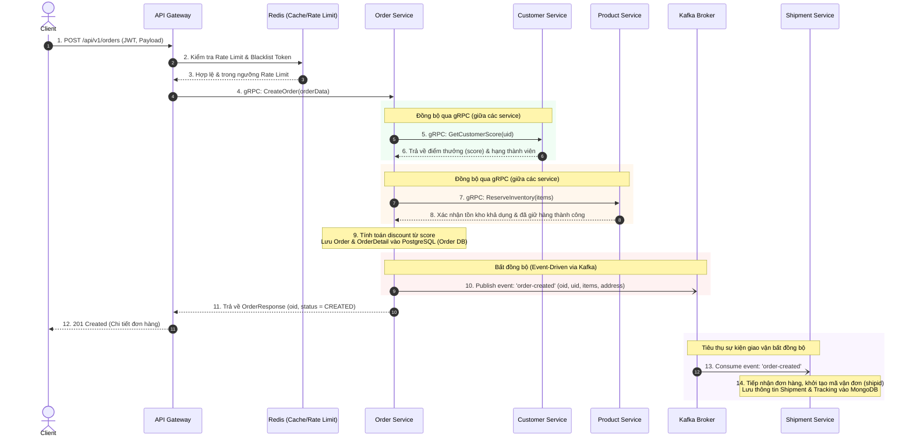

# Microservice Architecture Design

Tài liệu thiết kế kiến trúc hệ thống **E-commerce Microservices** phiên bản MVP (Minimum Viable Product) theo mô hình **Domain-Driven Design (DDD)**, **Database-per-Service** và **Event-Driven Architecture**, được chuyển hóa trực quan từ tài liệu thiết kế `Microservice-Architecture-Design.jpg`.

---

## 1. Sơ đồ kiến trúc tổng thể (Architecture Diagram)

Sơ đồ thể hiện toàn bộ các tầng trong hệ thống: Client, API Gateway kết hợp In-Memory Cache (Redis), 5 Microservices tương ứng 5 Bounded Contexts với cơ sở dữ liệu riêng biệt (PostgreSQL & MongoDB), cùng Message Broker (Apache Kafka) phục vụ truyền thông bất đồng bộ (Event-driven).

---

## 2. Bảng chú thích giao thức & kết nối (Legend)

| Ký hiệu | Loại kết nối / Giao thức | Phạm vi áp dụng | Đặc tính kỹ thuật |
| :---: | :--- | :--- | :--- |
| $\Longleftrightarrow$ | **REST API (HTTPS/JSON)** | Client $\leftrightarrow$ API Gateway | Giao tiếp đồng bộ (Synchronous), chuẩn định dạng JSON qua HTTPS, bảo vệ bằng JWT và SSL/TLS. |
| $\Longrightarrow$ | **gRPC (synchronous) (qua API Gateway)** | API Gateway $\rightarrow$ Các Microservices | Giao tiếp đồng bộ (Synchronous), giao thức HTTP/2 và Protobuf nhị phân hiệu năng cao, độ trễ thấp. |
| $\Longleftrightarrow$ | **gRPC (synchronous) (giữa các service)** | Customer $\leftrightarrow$ Order Order $\leftrightarrow$ Product | Giao tiếp trực tiếp nội bộ giữa các microservices khi cần tính toán dữ liệu tức thì (lấy điểm thưởng, kiểm tra và trừ tồn kho). |
| $-\;-\;\rightarrow$ | **Kafka (asynchronous)** | Order Service $\rightarrow$ Kafka $\rightarrow$ Shipment Service | Truyền thông bất đồng bộ hướng sự kiện (Event-Driven), đảm bảo loose-coupling, chịu lỗi và mở rộng độc lập. |
| $\Longleftrightarrow$ | **Kết nối cơ sở dữ liệu** | Service $\leftrightarrow$ Database tương ứng | Kết nối nội bộ theo nguyên tắc **Database-per-Service**; mỗi service chỉ truy cập trực tiếp vào DB của chính nó. |

---

## 3. Sơ đồ tương tác luồng xử lý mẫu: Tạo đơn hàng (Order Creation Flow)

Để làm rõ sự phối hợp giữa giao thức đồng bộ (gRPC) và bất đồng bộ (Kafka) trên sơ đồ, dưới đây là quy trình xử lý luồng đặt hàng hoàn chỉnh:

---

## 4. Đặc tả chi tiết các thành phần hệ thống

### 4.1. Client
- **Thiết bị hỗ trợ:** Laptop/Desktop Web Browser, Máy tính bảng (Tablet), Điện thoại thông minh (Mobile App).
- **Giao thức kết nối:** HTTPS / REST API với payload định dạng JSON tiêu chuẩn.
- **Bảo mật:** Gửi kèm JWT (JSON Web Token) trong header `Authorization: Bearer <token>` trên mỗi request được chứng thực.

---

### 4.2. API Gateway & Redis (API Gateway DB)

#### API Gateway
Đóng vai trò là điểm tiếp nhận duy nhất (**Single Entry Point**) cho toàn bộ các request ngoại vi từ Client.
- **Xác thực & ủy quyền (Authentication & Authorization):** Kiểm tra tính hợp lệ của JWT, trích xuất Claims (role, uid) và phân quyền truy cập endpoint.
- **Định tuyến request (Reverse Proxy & Routing):** Chuyển đổi các HTTP REST request thành các cuộc gọi gRPC tương ứng đến các microservice nội bộ.
- **Giới hạn tốc độ (Rate Limiting):** Ngăn chặn tấn công DoS/DDoS hoặc brute-force bằng thuật toán Token Bucket / Leaky Bucket.
- **Ghi log & giám sát (Logging & Monitoring):** Ghi nhận Access Log tập trung, tính toán Latency và phân phối Trace ID cho phân tích phân tán.

#### Redis (API Gateway DB)
Cơ sở dữ liệu In-Memory đóng vai trò bộ nhớ đệm tốc độ cao cho API Gateway:
- **Lưu cache token:** Lưu trữ Token Blacklist / Refresh Token để vô hiệu hóa phiên tức thì khi người dùng đăng xuất.
- **Lưu session:** Quản lý phiên làm việc tập trung của người dùng.
- **Rate limiting counter:** Lưu bộ đếm request theo IP hoặc theo User ID với cơ chế tự động hết hạn (TTL).
- **Cache dữ liệu:** Cache phản hồi của các dữ liệu ít biến động nhằm giảm tải cho các dịch vụ phía sau.

---

### 4.3. Các Bounded Context Microservices & Databases

#### 1. Auth Service
- **Nhiệm vụ:**
  - Quản lý tài khoản (Đăng ký, cập nhật thông tin tài khoản, đổi mật khẩu).
  - Xác thực người dùng (Đăng nhập, băm mật khẩu an toàn bcrypt/argon2, cấp phát JWT).
  - Quản lý vai trò (Role-based Access Control - RBAC: Admin, Customer, Staff,...).
- **Cơ sở dữ liệu:** `PostgreSQL (Auth DB)` (RDBMS đảm bảo tính toàn vẹn ACID).
  - Bảng `User`: Lưu thông tin đăng nhập (`uid`, `username`, `password`, `roleid`).
  - Bảng `Role`: Định nghĩa danh sách các vai trò (`roleid`, `rolename`).

#### 2. Customer Service
- **Nhiệm vụ:**
  - Quản lý thông tin chi tiết hồ sơ khách hàng (Họ tên, địa chỉ, liên hệ).
  - Quản lý các cấp độ/hạng thành viên (Silver, Gold, Platinum,...).
  - Cung cấp điểm số tích lũy (`score`) phục vụ việc tính toán chiết khấu.
- **Cơ sở dữ liệu:** `PostgreSQL (Customer DB)`.
  - Bảng `Customer`: Lưu hồ sơ khách hàng (`uid`, `fullname`, `mid`).
  - Bảng `Membership`: Quản lý các hạng thành viên và mốc điểm (`mid`, `mname`, `score`).

#### 3. Order Service
- **Nhiệm vụ:**
  - Quản lý vòng đời đơn đặt hàng (Tiếp nhận, xử lý, hủy đơn).
  - Tính toán mức giảm giá (`discount`) dựa trên điểm số lấy từ Customer Service qua gRPC.
  - Quản lý chi tiết từng dòng sản phẩm trong đơn hàng.
  - Xuất sự kiện đơn hàng thành công sang Message Broker (Kafka).
- **Giao tiếp liên service:**
  - Gọi Customer Service qua **gRPC** để lấy điểm `score`.
  - Gọi Product Service qua **gRPC** để kiểm tra giá và trừ tồn kho.
  - Xuất sự kiện `order-created` sang **Kafka**.
- **Cơ sở dữ liệu:** `PostgreSQL (Order DB)`.
  - Bảng `Order`: Lưu thông tin tổng quát đơn hàng (`oid`, `uid`, `discount`, `created_at`).
  - Bảng `OrderDetail`: Lưu chi tiết các mặt hàng (`oid`, `pid`, `qty`, `unit_price`).

#### 4. Product Service
- **Nhiệm vụ:**
  - Quản lý danh mục sản phẩm (CRUD sản phẩm, hình ảnh, phân loại, giá bán).
  - Kiểm tra và cập nhật tồn kho (Inventory verification & deduction).
  - Cung cấp thông tin sản phẩm cho các service khác qua gRPC.
- **Cơ sở dữ liệu:** `MongoDB (Product DB)` (Document-oriented NoSQL linh hoạt schema, hỗ trợ mở rộng sản phẩm đa thuộc tính).
  - Collection `Product`: Lưu dữ liệu sản phẩm (`pid`, `pname`, `price`, thông số chi tiết).
  - Collection `Inventory`: Quản lý số lượng tồn kho khả dụng (`quantity`).

#### 5. Shipment Service
- **Nhiệm vụ:**
  - Tiếp nhận đơn hàng cần giao vận thông qua việc lắng nghe sự kiện từ Kafka.
  - Cập nhật trạng thái giao nhận (Pending $\rightarrow$ Picked $\rightarrow$ Shipping $\rightarrow$ Delivered $\rightarrow$ Returned).
  - Quản lý thông tin nhà vận chuyển và lịch trình di chuyển (Tracking history).
- **Giao tiếp liên service:**
  - Tiêu thụ sự kiện `order-created` từ **Kafka** theo mô hình Publisher/Subscriber.
- **Cơ sở dữ liệu:** `MongoDB (Shipment DB)`.
  - Collection `Shipment`: Thông tin vận đơn (`shipid`, `oid`, `status`, nhà vận chuyển).
  - Collection `Tracking`: Nhật ký hành trình vận chuyển theo dòng thời gian.

---

### 4.4. Message Broker (Apache Kafka)
- **Vai trò:** Cung cấp hạ tầng truyền thông hướng sự kiện bất đồng bộ (Asynchronous Event Streaming).
- **Lợi ích kiến trúc:**
  - **Decoupling (Phân tách phụ thuộc):** `Order Service` không cần biết chi tiết triển khai hay địa chỉ mạng của `Shipment Service`.
  - **Khả năng chịu tải (Buffering / Load Leveling):** Khi lượng đặt hàng tăng vọt (Flash Sale), Kafka lưu giữ các sự kiện trong hàng đợi, giúp `Shipment Service` tiêu thụ tuần tự mà không bị sập (overwhelmed).
  - **Đảm bảo độ tin cậy:** Cơ chế ACK và Offset Commit đảm bảo sự kiện không bị mất mát khi gặp sự cố mạng hoặc khởi động lại dịch vụ.
- **Topics chính:**
  - `order-created`: Xuất phát từ Order Service khi đơn hàng được tạo lập thành công.
  - *(Các topic mở rộng khác: `payment-completed`, `shipment-updated`, `inventory-adjusted`,...)*.

---

## 5. Bảng tổng hợp công nghệ & mẫu kiến trúc (Architectural Patterns)

| Tiêu chí | Giải pháp công nghệ / Mẫu kiến trúc áp dụng |
| :--- | :--- |
| **Kiến trúc tổng thể** | Microservices Architecture kết hợp Domain-Driven Design (DDD). |
| **Mô hình dữ liệu** | **Database-per-Service**: Đảm bảo phân tách hoàn toàn ranh giới dữ liệu, không chia sẻ database giữa các dịch vụ. |
| **Cơ sở dữ liệu SQL** | PostgreSQL cho Auth, Customer, Order (đảm bảo tính toàn vẹn giao dịch ACID). |
| **Cơ sở dữ liệu NoSQL** | MongoDB cho Product và Shipment (tính linh hoạt cao, mô hình Document JSON tự nhiên). |
| **In-Memory Cache** | Redis cho API Gateway (Caching, Session Store, Rate Limiting). |
| **Giao tiếp đồng bộ** | **gRPC (Protobuf)**: Tối ưu băng thông mạng, chuyển đổi dữ liệu nhị phân tốc độ cao giữa Gateway và Microservices, cũng như giữa các Microservices. |
| **Giao tiếp bất đồng bộ** | **Apache Kafka**: Triển khai mẫu Publish-Subscribe / Event-Driven Architecture. |
| **Tính nhất quán dữ liệu** | **Eventual Consistency (Nhất quán cuối cùng)**: Xử lý giao vận qua Kafka thay vì 2-Phase Commit (2PC) cồng kềnh. |
